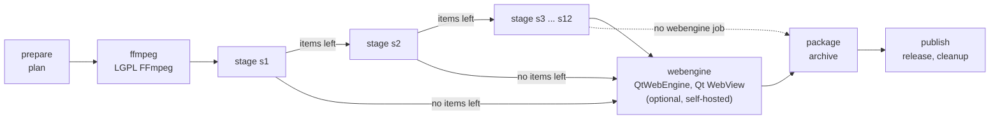

# vivace-qt-build

This repository builds open-source (OSS) Qt from source with the Qt Multimedia
patches that the [Vivace](https://github.com/Sportacandy/vivace) media player
needs. GitHub Actions workflows build one Qt kit per platform and publish each
kit as an archive.

The first supported Qt version is 6.12.0.

This repository also builds and releases an LGPL FFmpeg 7.1 for Windows,
Linux, and macOS. Read [FFmpeg distribution](#ffmpeg-distribution).

## License overview

| What | License | License text |
|------|---------|--------------|
| Scripts and workflows: `tools/`, `versions/`, `.github/` | GPL-3.0-or-later | [LICENSE](LICENSE) |
| The same scripts in `vivace-build/` of a kit archive and in `vivace-qt-build/` of a source archive | GPL-3.0-or-later | `LICENSE` next to them |
| Patches: `patches/` | LGPL-3.0-only OR GPL-2.0-only OR GPL-3.0-only | [patches/LICENSE](patches/LICENSE) |
| SoundTouch, which the WSOLA patch adds to Qt Multimedia | LGPL-2.1-or-later | [patches/LICENSE](patches/LICENSE), and the SoundTouch files |
| Qt in the kit archives | Most modules: the LGPL v3, alone or with GPL options. Some modules: GPL-3.0-only (see below). Each Qt source file states its license. | The Qt source files |
| The patches in the kit archives | Same as `patches/` | `vivace-patches/LICENSE` in the archive |
| FFmpeg in the kit archives and in the FFmpeg archives | LGPL-2.1-or-later | `licenses/ffmpeg/` in a kit archive, `licenses/` in an FFmpeg archive |
| Parts inside FFmpeg: dav1d | BSD-2-Clause | Same directory as FFmpeg |
| FFmpeg files with own terms, for example `speexdec.c`, `x86inc.asm` | BSD, MIT, or ISC | `ffmpeg-THIRD-PARTY-NOTICES.txt`, same directory as FFmpeg |
| Part inside the MSVC FFmpeg: zlib | Zlib | Same directory as FFmpeg |
| The MSVC C and C++ runtime, linked statically into the MSVC FFmpeg (`/MT`) | Microsoft Visual C++ distributable code | No notice needed |
| Third-party code inside Qt modules, for example PCRE2, libpng, FreeType, and HarfBuzz | Their own licenses | `licenses/qt/<module>/` and its `ATTRIBUTIONS.txt` |
| Qt documentation | GFDL-1.3-no-invariants-only | `licenses/qt/<module>/LICENSES/` |
| Qt example sources | BSD-3-Clause | `licenses/qt/<module>/LICENSES/` |
| Most Qt tools, for example Qt Designer and `qmllint` | GPL-3.0-only WITH Qt-GPL-exception-1.0 | `licenses/qt/<module>/LICENSES/` |
| Chromium's FFmpeg inside Qt WebEngine Core (`webengine` kits) | LGPL-2.1-or-later | Qt WebEngine sources, commit in `BUILDINFO-vivace.txt` |
| Chromium's other third-party code inside Qt WebEngine Core | Their own licenses | `licenses/qt/qtwebengine/third_party/` |
| Part files with own terms, for example an ISC file in libaribcaption | BSD, ISC, or MIT | `<part>-NOTICES.txt`, same directory as FFmpeg |
| Parts inside FFmpeg: libvpl, libaribcaption, nv-codec-headers, AMF headers | MIT | Same directory as FFmpeg |
| MinGW parts: the MinGW-w64 runtime | Public domain, ZPL-2.1, BSD-style, and other permissive terms | `licenses/mingw/`, and the FFmpeg directory |
| MinGW parts: winpthreads | MIT and BSD | `licenses/mingw/`, and the FFmpeg directory |
| MinGW parts: zlib (FFmpeg only) | Zlib | The FFmpeg directory |
| OpenSSL 3, linked statically into the OpenSSL TLS plugin of the Android kits | Apache-2.0 | `licenses/openssl/` in the Android kit archives |
| MinGW parts: the GCC runtime (`libgcc`, `libstdc++`) | GPL-3.0-or-later WITH GCC-exception-3.1 | `licenses/mingw/`, and the FFmpeg directory |

The MinGW parts are inside the MinGW FFmpeg and inside the Qt libraries of
the `mingw1310_64` kit, because both link them statically.

Not everything in the kit archives is under the LGPL. Under open-source
terms, the libraries of these Qt repositories are GPL-3.0-only. Their
installed Qt 6.12.0 headers say `LicenseRef-Qt-Commercial OR GPL-3.0-only`:

| Repository | Libraries |
|------------|-----------|
| `qtcharts` | Qt Charts |
| `qtdatavis3d` | Qt Data Visualization |
| `qtgraphs` | Qt Graphs |
| `qtquick3d` | Qt Quick 3D, including its particles, helpers, asset tools, and XR |
| `qtquick3dphysics` | Qt Quick 3D Physics |
| `qtquicktimeline` | Qt Quick Timeline |
| `qtlottie` | Qt Lottie Animation |
| `qtvirtualkeyboard` | Qt Virtual Keyboard |
| `qtgrpc` | Qt gRPC |
| `qthttpserver` | Qt HTTP Server |
| `qtnetworkauth` | Qt Network Authorization |
| `qtcoap` | Qt CoAP |
| `qtmqtt` | Qt MQTT |
| `qtcanvaspainter` | Qt Canvas Painter, Qt Canvas 2D |
| `qtwayland` (`gcc_64`, `gcc_arm64`, and `gcc_arm64_ubuntu` only) | Qt Wayland Compositor. The Wayland client plugin is LGPL. |
| `qtquickeffectmaker` | Qt Quick Effect Maker (`qqem`), a tool without the Qt GPL exception |

The test libraries Qt Multimedia Test Lib, Qt Quick Test Utils, and Qt Quick
Controls Test Utils are GPL-3.0-only too. An application that uses one of
these libraries must follow the GPL v3, or use a commercial Qt license. The
Qt Designer libraries (Qt Designer, Qt Designer Components) and the tools,
for example `qmllint` and the QML compiler, are GPL-3.0-only with the Qt GPL
exception. The exception covers the output of the tools, not a program that
links these libraries, for example a Qt Designer plugin. To leave out a
GPL-only repository,
add it to `skip_modules`. Before you use another Qt module, check the
license line in its headers.

The FFmpeg in the kit archives and in the FFmpeg archives is under the LGPL
v2.1 or later. Its parts are under licenses that allow this use. The GCC
runtime exception lets the MinGW FFmpeg and the MinGW Qt libraries contain the
GCC runtime without the GPL.


The GPL of the scripts does not apply to the archives that the scripts
build. The build stops if FFmpeg reports a license other than "LGPL version
2.1 or later". The section [License](#license) has the details.

## Terminology

This README and the code use these terms with one meaning each.

| Term | Meaning |
|------|---------|
| kit | One Qt installation for one compiler and target, for example `msvc2022_64`. |
| module | One Qt git repository, for example `qtbase` or `qtmultimedia`. |
| prefix | The directory that contains an installed kit, for example `C:/Qt/6.12.0/msvc2022_64`. |
| item | One unit of work: build and install one module, or make the docs of one module. |
| stage | One workflow job that runs items until it uses its time budget. |
| state | The saved prefix plus the list of finished items, passed from stage to stage. |

## The patches

The patches are in [`patches/6.12.0/qtmultimedia/`](patches/6.12.0/qtmultimedia/).
They are copies of the files in the Vivace repository at commit `2045359`
("Bump Qt to 6.12.0"), with one change: the license. The files that the
patches add are under `LGPL-3.0-only OR GPL-2.0-only OR GPL-3.0-only`, as
Qt Multimedia is. At that commit, they were under `GPL-3.0-or-later`. Each
patch file starts with a description of the problem and the change.

| Patch | Change |
|-------|--------|
| `qtmultimedia-av1-hwaccel-disable.patch` | Uses only the `libdav1d` software decoder for AV1, because AV1 hardware decoding can hang. |
| `qtmultimedia-deinterlace.patch` | Adds Yadif and Bwdif deinterlacing with an FFmpeg `avfilter` graph. |
| `qtmultimedia-subtitle-bitmap.patch` | Fixes a crash on bitmap subtitles (DVD, PGS, DVB) and adds bitmap subtitle display. |
| `qtmultimedia-wsola-pitch-compensation.patch` | Uses WSOLA (SoundTouch) for pitch compensation above 1x playback speed. |

The build applies every `patches/<qt_version>/<module>/*.patch` file to its
module in file-name order with `git apply`. Each kit archive also contains the
patches in `vivace-patches/`, the build scripts and the version file in
`vivace-build/`, and a `BUILDINFO-vivace.txt` file. That file records the
repository and the commit of each module, the patch checksums, and the
dependency versions.

## FFmpeg

Qt Multimedia plays media with FFmpeg, and each kit archive contains the
FFmpeg libraries. This repository also releases the same FFmpeg on its own,
for applications that link FFmpeg directly. The libraries must be under the
LGPL, so the build makes its own FFmpeg from source. It does not use a
prebuilt FFmpeg. Most prebuilt FFmpeg packages, for example the BtbN
`gpl-shared` builds and the Homebrew `ffmpeg` formula, contain GPL code.

`tools/build-ffmpeg.sh` builds the FFmpeg of a kit with the compiler of the
kit:

| Kit | FFmpeg build | Released as |
|-----|--------------|-------------|
| `msvc2022_64` | MSVC in MSYS2, on the Windows runner of the kit | `ffmpeg-7.1.5-lgpl-win64-msvc.zip` |
| `mingw1310_64` | MinGW 13.1 in MSYS2, on the Windows runner of the kit | `ffmpeg-7.1.5-lgpl-win64-mingw.zip` |
| `gcc_64` | GCC, on the Linux runner of the kit | `ffmpeg-7.1.5-lgpl-linux-x64.tar.xz` |
| `gcc_arm64` | GCC, in the `debian:bookworm` container of the kit | Not released. The kit archive and the release have its source. |
| `gcc_arm64_ubuntu` | GCC, on the Linux arm64 runner of the kit | Not released. The kit archive and the release have its source. |
| `macos` | Clang, on the macOS runner of the kit (arm64 only) | `ffmpeg-7.1.5-lgpl-macos-arm64.tar.xz` |
| `android_arm64_v8a`, `android_x86_64` | The Android NDK, on `ubuntu-24.04` | Not released |

### Contents

The recipe is `toolchains.ffmpeg` in `versions/<qt_version>.json`. Each
source archive has a SHA-256 checksum in the recipe.

- FFmpeg 7.1.5: shared libraries, and the `ffmpeg` and `ffprobe` programs.
  The configure options start from those that Qt uses for its own FFmpeg
  (`coin/provisioning` in qt5.git). The changes:
  - `avfilter` stays on, for the deinterlace patch.
  - `libdav1d` is on, for the AV1 patch.
  - The build makes the programs (`--disable-ffplay` instead of
    `--disable-programs`).
  - The encoders and libraries of [Encoders](#encoders) are on: NVENC, QSV, AMF,
    Media Foundation, VA-API, VideoToolbox, and libaribcaption.
  - MinGW: iconv is off.
  - MSVC: zlib 1.3.2 is a part (`--enable-zlib`), as in the FFmpeg of Qt.
    The other kits use the zlib of the system or of MinGW.
- Linked statically into the FFmpeg libraries:

  | Part | License | Kits |
  |------|---------|------|
  | dav1d 1.5.4 (AV1 decoder) | BSD-2-Clause | All |
  | libvpl 2.17.0 (Intel QSV) | MIT | Windows, Linux |
  | libaribcaption 1.1.2 (ARIB captions) | MIT | Windows, Linux, macOS |
  | winpthreads, from MinGW 13.1 (`clock_gettime`) | MIT and BSD | MinGW |
  | zlib 1.3.2 | Zlib | MSVC |
  | zlib, from MinGW 13.1 | Zlib | MinGW |
  | GCC runtime (`libgcc`, `libstdc++`), from MinGW 13.1 | GPL-3.0-or-later WITH GCC-exception-3.1 | MinGW |

- Headers only: nv-codec-headers 12.0.16.1 (MIT, NVIDIA) on Windows and
  Linux, and the AMF headers 1.4.36 (MIT, AMD) on Windows.
- The encoders of the platform SDKs: Media Foundation on Windows, VA-API on
  Linux, and VideoToolbox on macOS.

The decoders, demuxers, and muxers of FFmpeg stay on, for example the
`mpeg2video`, `h264`, `hevc`, `aac`, `ac3`, and `mov_text` decoders, and the
`mpeg2video` encoder.

### Encoders

The FFmpeg of each kit has the encoders of its platform, and the software
encoders of FFmpeg.

Hardware and operating system encoders:

| Kit | Encoders |
|-----|----------|
| `msvc2022_64`, `mingw1310_64` | NVIDIA NVENC: `h264_nvenc`, `hevc_nvenc`, `av1_nvenc`. Intel QSV: `h264_qsv`, `hevc_qsv`, `av1_qsv`, `vp9_qsv`, `mpeg2_qsv`, `mjpeg_qsv`. AMD AMF: `h264_amf`, `hevc_amf`, `av1_amf`. Media Foundation: `h264_mf`, `hevc_mf`, `aac_mf`, `ac3_mf`, `mp3_mf`. Direct3D 12, `msvc2022_64` only: `hevc_d3d12va`. |
| `gcc_64` | NVIDIA NVENC: `h264_nvenc`, `hevc_nvenc`, `av1_nvenc`. Intel QSV: `h264_qsv`, `hevc_qsv`, `av1_qsv`. VA-API: `h264_vaapi`, `hevc_vaapi`, `av1_vaapi`. |
| `gcc_arm64`, `gcc_arm64_ubuntu` | VA-API: `h264_vaapi`, `hevc_vaapi`, `av1_vaapi`. The `linux_arm64` option set (`ffmpeg_options` of the kit) leaves out QSV, which is x86 only, and NVENC, because the target boards have no NVIDIA GPU. Raspberry Pi has no VA-API driver, and the common options turn off V4L2 M2M, so the kit has no hardware encoder on Raspberry Pi. |
| `macos` | VideoToolbox: `h264_videotoolbox`, `hevc_videotoolbox`. |
| `android_arm64_v8a`, `android_x86_64` | MediaCodec encoders of FFmpeg. The Android FFmpeg has no programs, so the checks do not list them. |

Software encoders, on all kits:

```text
Video:
  a64multi, a64multi5, alias_pix, amv, apng, asv1, asv2, avrp, avui,
  bitpacked, bmp, cfhd, cinepak, cljr, dnxhd, dpx, dvvideo, dxv, exr, ffv1,
  ffvhuff, fits, flashsv, flashsv2, flv, gif, h261, h263, h263p, hdr,
  huffyuv, jpeg2000, jpegls, ljpeg, magicyuv, mjpeg, mpeg1video, mpeg2video,
  mpeg4, msmpeg4, msmpeg4v2, msrle, msvideo1, pam, pbm, pcx, pfm, pgm,
  pgmyuv, phm, png, ppm, prores, prores_aw, prores_ks, qoi, qtrle, r10k,
  r210, rawvideo, roqvideo, rpza, rv10, rv20, sgi, smc, snow, speedhq,
  sunrast, svq1, targa, tiff, utvideo, v210, v308, v408, v410, vbn, vc2,
  vnull, wbmp, wmv1, wmv2, wrapped_avframe, xbm, xface, xwd, y41p, yuv4,
  zlib, zmbv
Audio:
  aac, ac3, ac3_fixed, adpcm_adx, adpcm_argo, adpcm_ima_alp, adpcm_ima_amv,
  adpcm_ima_apm, adpcm_ima_qt, adpcm_ima_ssi, adpcm_ima_wav, adpcm_ima_ws,
  adpcm_ms, adpcm_swf, adpcm_yamaha, alac, anull, aptx, aptx_hd,
  comfortnoise, dca, dfpwm, eac3, flac, g722, g723_1, g726, g726le, mlp,
  mp2, mp2fixed, nellymoser, opus, pcm_* (31 formats), real_144, roq_dpcm,
  s302m, sbc, sonic, sonicls, truehd, tta, vorbis, wavpack, wmav1, wmav2
Subtitles:
  ass, dvbsub, dvdsub, mov_text, srt, ssa, subrip, text, ttml, webvtt, xsub
```

The list comes from a local build of the `msvc2022_64` FFmpeg. The Linux and
macOS lists of hardware encoders show the encoders that the checks require.
The FFmpeg of a platform can have more. `<name>-checks.txt` of each FFmpeg
release has the complete output of `ffmpeg -encoders` for that platform.

There is no software encoder for H.264, HEVC, AV1, or VP9. FFmpeg has these
encoders only through external libraries: libx264 and libx265 are GPL, and
the build does not include libaom, SVT-AV1, or libvpx. To encode these
formats, use a hardware encoder. On Windows, `h264_mf` and `hevc_mf` can
also use the software encoders of Media Foundation, if Windows has them.

### License gate and checks

The build stops unless FFmpeg reports the license "LGPL version 2.1 or
later". The stage jobs do the same check before they use the FFmpeg. So an
option that adds GPL or nonfree code stops the build.

A build writes a list of its files with their SHA-256 checksums. If an
FFmpeg from the cache does not match this list, for example after a restore
that stopped part-way, `build-ffmpeg` builds FFmpeg again.

After the build, and also for an FFmpeg from the cache, `build-ffmpeg` runs
these checks with the `ffmpeg` program. They do not run for the Android
kits, which have no programs.

1. `ffmpeg -hide_banner -version` must not show `--enable-gpl` or
   `--enable-nonfree`, and `ffmpeg -hide_banner -L` must name the GNU Lesser
   General Public License.
2. `ffmpeg -hide_banner -encoders` must list the encoders that `checks` in the
   recipe names for the platform:

   | Kit | Encoders |
   |-----|----------|
   | `msvc2022_64`, `mingw1310_64` | `h264_nvenc`, `hevc_nvenc`, `av1_nvenc`, `h264_qsv`, `hevc_qsv`, `av1_qsv`, `h264_amf`, `hevc_amf`, `av1_amf`, `h264_mf`, `hevc_mf`, `mpeg2video` |
   | `gcc_64` | `h264_nvenc`, `hevc_nvenc`, `av1_nvenc`, `h264_qsv`, `hevc_qsv`, `av1_qsv`, `h264_vaapi`, `hevc_vaapi`, `av1_vaapi`, `mpeg2video` |
   | `gcc_arm64`, `gcc_arm64_ubuntu` | `h264_vaapi`, `hevc_vaapi`, `av1_vaapi`, `mpeg2video` |
   | `macos` | `h264_videotoolbox`, `hevc_videotoolbox`, `mpeg2video` |

3. `ffmpeg -hide_banner -decoders` must list `libaribcaption`, `png`, and the decoders
   in [Contents](#contents). `-demuxers` must list `mpegts` and `mov`, and `-muxers` must list
   `mpegts` and `mp4`.
4. On Windows: `dumpbin /dependents` on each DLL and program must not show
   `libx264`, `libx265`, or a MinGW runtime DLL. For the MSVC FFmpeg, it must
   also not show a DLL of the MSVC runtime (`vcruntime`, `msvcp`, `ucrtbase`,
   or `api-ms-win-crt-*`).

A failed check stops the job. `FFMPEG-CHECKS.txt` in the FFmpeg directory
has the output of all checks.

### Build FFmpeg workflow

1. Open **Actions** > **Build FFmpeg** > **Run workflow**.
2. In **kits**, type `all` or a comma-separated list without spaces, for
   example `msvc2022_64,gcc_64`.
3. Optional: in **release_tag**, type a tag name, for example
   `ffmpeg-7.1.5-r1`. The workflow creates the GitHub release if it does not
   exist.
4. Select **Run workflow**.

Each kit uploads these files as the workflow artifact `ffmpeg-release-<kit>`,
and to the release if you set **release_tag**:

- `<name>.zip` or `<name>.tar.xz`, and its `.sha256` file. The archive has
  `bin/`, `include/`, `lib/`, `licenses/`, and `FFMPEG-CHECKS.txt`.
- `<name>-checks.txt`: the output of the checks.
- `<name>-source.tar`: the source archives of FFmpeg and its parts, and
  `FFMPEG-SOURCE.txt`.

The workflow uses the runner variables of **Build Qt**. It shares the build
and the cache with the `ffmpeg` job of **Build Qt**, so a later Qt build of
the same kit uses the FFmpeg from the cache. GitHub caches are per branch: a
run sees the caches of its own branch and of the default branch.

### FFmpeg distribution

This repository distributes FFmpeg in these forms:

| Form | Where | Contents |
|------|-------|----------|
| Kit archive | **Build Qt** releases, `qt-<qt_version>-<kit>` artifacts | Libraries, and license files in `licenses/ffmpeg/` |
| FFmpeg archive | **Build FFmpeg** releases, `ffmpeg-release-<kit>` artifacts | Libraries, `ffmpeg`, `ffprobe`, headers, import libraries, and license files in `licenses/` |
| Intermediate artifacts of a **Build Qt** run | `ffmpeg-<kit>`, `state-<kit>-...`, `host-qt-<qt_version>-<kit>` (7 days) | The FFmpeg directory, or a prefix that contains FFmpeg. Each saved prefix also has `BUILDINFO-vivace.txt`, `vivace-patches/`, and `vivace-build/`. |

Each form comes with a source archive from the same place: `<kit archive
name>-ffmpeg-source.tar` or `<FFmpeg archive name>-source.tar` in the
release, and the `ffmpeg-source-<kit>` artifact (14 days) in a **Build Qt**
run. The stage jobs also put the source archive into each state, so every
`state-...` and `host-qt-...` artifact carries it. The `ffmpeg` job uploads
the source archive before the FFmpeg, and the releases upload it before the
archives. A new **Build FFmpeg** release stays
a draft until the workflow uploads all files. A published release that a
later run updates is a draft again for the time of the uploads.

The source archive contains the exact source archives of FFmpeg and of each part, and `FFMPEG-SOURCE.txt`
with their URLs, their SHA-256 checksums, and the configure options. It also
contains the scripts that control the build in `vivace-qt-build/`
(`tools/build-ffmpeg.sh`, `tools/qtci.py`, the composite action, and their
GPL license), `recipe.json` with every input of the build and the SHA-256
values of the scripts, and `BUILD-INFO.txt`. The workflow files
(`ffmpeg.yml`, `kit.yml`) only start these scripts, and the archive does not
contain them. `BUILD-INFO.txt` names the commit of this repository that has
them. Before a **Build Qt** package job uses this archive, it checks the
source archives, the scripts, and the text files against the recipe. A **Build Qt** run also
uploads this archive as the artifact `ffmpeg-source-<kit>`, next to the
`ffmpeg-<kit>` artifact that the stage jobs use.

Each FFmpeg library is a shared library (a DLL, `.so`, or `.dylib` file). A
user can replace it with another build of the same FFmpeg version. One
exception: a kit built with `webengine` also contains the FFmpeg of
Chromium, compiled into Qt WebEngine Core. That FFmpeg is LGPL too, but it
is not a separate library, and the checks of this section do not cover it.
Its source is in the Qt WebEngine repository at the commit that
`BUILDINFO-vivace.txt` names. The build
links the parts statically into the FFmpeg libraries. The parts are under the
BSD-2-Clause, ISC, MIT, or Zlib license. The MinGW FFmpeg also contains the
MinGW-w64 runtime (public domain, ZPL-2.1, BSD-style, and other permissive
terms in its license file), winpthreads (MIT and BSD),
and the GCC runtime (GPL with the GCC runtime library exception).

If you redistribute this FFmpeg, for example with an application:

- Ship the license files of `licenses/` with it.
- Offer the source code: ship the source archive, or say where your users
  can get it.
- Keep the FFmpeg libraries as separate shared libraries, so that your users
  can replace them.
- Do not add GPL libraries to it, for example libx264 or libx265.

### FFmpeg in the kit archives

Each kit archive contains the FFmpeg license files in `licenses/ffmpeg/`.
`FFMPEG-SOURCE.txt` in that directory lists the source archives, their
checksums, and the configure options. The `package` job also writes
`<archive name without extension>-ffmpeg-source.tar` with the source archives.
If you set **release_tag**, `publish` uploads it to the release next to the
kit archive.

## Kits

| Kit | Runner | Based on local script | Archive |
|-----|--------|-----------------------|---------|
| `msvc2022_64` | `windows-2022` | `opensource-qtmake6120-msvc2022.bat`, `...-msvc2022-qtwebengine.bat` | `qt-6.12.0-oss-self-built-msvc2022_64.zip` |
| `mingw1310_64` | `windows-2022` | `opensource-qtmake6120-mingw-1310.bat` | `qt-6.12.0-oss-self-built-mingw1310_64.zip` |
| `android_arm64_v8a` | `windows-2022` | `opensource-qtmake6120-android-arm64-v8a-on-mingw-1310.bat` | `qt-6.12.0-oss-self-built-android_arm64_v8a.zip` |
| `android_x86_64` | `windows-2022` | `opensource-qtmake6120-android-x86_64-on-mingw-1310.bat` | `qt-6.12.0-oss-self-built-android_x86_64.zip` |
| `gcc_64` | `ubuntu-24.04` | `6.11.1/qtmake6.sh` | `qt-6.12.0-oss-self-built-linux_x64.tar.xz` |
| `gcc_arm64` | `ubuntu-24.04-arm`, in a `debian:bookworm` container | None | `qt-6.12.0-oss-self-built-linux_arm64.tar.xz` |
| `gcc_arm64_ubuntu` | `ubuntu-24.04-arm` | None | `qt-6.12.0-oss-self-built-linux_arm64_ubuntu.tar.xz` |
| `macos` | `macos-15` (arm64) | `6.11.1/qtmake6-macos.sh` | `qt-6.12.0-oss-self-built-macos_arm64.tar.xz` |

Each archive has one top-level directory, `6.12.0/<kit>/`. Extract it into the
prefix root (`C:\Qt`, `/opt/Qt`, or `~/Qt`) to get the same prefix that the
build used.

The Android kits use the `mingw1310_64` kit as the host Qt (`QT_HOST_PATH`),
the same as the local `*-on-mingw-1310.bat` scripts.

The `gcc_arm64` kit is for Linux on arm64 based on Debian 12, for example
Raspberry Pi OS (Legacy, 64-bit), the release for Debian 12 "bookworm".
Its `ffmpeg`, stage, and `package` jobs run in the
`debian:bookworm` container that the kit names (`container` in
`versions/<qt_version>.json`). So the kit links the libraries of Debian 12,
for example glibc 2.36 and ICU 72, and runs on Debian 12 and on Raspberry Pi
OS based on Debian 12. Other distributions do not have the same library
versions. Examples are Ubuntu 24.04 and the current Raspberry Pi OS, which is
based on Debian 13 "trixie" and has ICU 76. The first step of each of these jobs installs
`sudo`, Git, curl, xz, zstd, and a Python 3.12 into the container.
The kit has no docs. Its QtWebEngine needs a self-hosted runner that runs
Debian 12 on arm64; read [QtWebEngine](#qtwebengine) and
[Known limitations](#known-limitations).

The `gcc_arm64_ubuntu` kit has the same configuration as `gcc_arm64`, but
its jobs run directly on the `ubuntu-24.04-arm` runner, without a
container. So the kit links the libraries of Ubuntu 24.04, for example
glibc 2.39 and ICU 74, and runs on Ubuntu 24.04 on arm64, but not on
Debian 12. It also has no docs, and its QtWebEngine needs a self-hosted
Ubuntu 24.04 arm64 runner.

The configure options of each kit are in
[`versions/6.12.0.json`](versions/6.12.0.json), under `kits`. They follow the
local scripts. The section [Differences from the local scripts](#differences-from-the-local-scripts)
lists every change.

## Build a kit

1. Open **Actions** > **Build Qt** > **Run workflow**.
2. In **kits**, type `all` or a comma-separated list without spaces, for example
   `msvc2022_64,gcc_64`.
3. Optional: in **release_tag**, type a tag name, for example `qt-6.12.0-r1`.
   The workflow creates the GitHub release if it does not exist, and uploads
   the archives to it.
4. Select **Run workflow**.

Only one run builds a kit at a time. If you start a second run, its job for
that kit waits until the first run ends. If you start a third run while the
second one waits, GitHub cancels the waiting job of the second run.

Each kit uploads its archive as the workflow artifact `qt-<qt_version>-<kit>`.
Artifacts expire after 14 days. A release asset must be smaller than 2 GiB. If
you set **release_tag**, archives that are larger than 1900 MiB are split into
parts named `<archive>.001`, `<archive>.002`, and so on. The workflow artifact
then also contains the parts, not one archive.

To join split parts, run one of these commands:

```sh
cat qt-6.12.0-oss-self-built-msvc2022_64.zip.0* > qt-6.12.0-oss-self-built-msvc2022_64.zip
```

```bat
copy /b qt-6.12.0-oss-self-built-msvc2022_64.zip.001+qt-6.12.0-oss-self-built-msvc2022_64.zip.002 qt-6.12.0-oss-self-built-msvc2022_64.zip
```

Compare the result with the `.sha256` file before you use it.

### Workflow inputs

| Input | Default | Description |
|-------|---------|-------------|
| `qt_version` | `6.12.0` | Qt version. The file `versions/<qt_version>.json` must exist. |
| `kits` | `all` | Kits to build. |
| `docs` | `kit-default` | `on` or `off` overrides the `docs` value of each kit. All kits except `gcc_arm64` and `gcc_arm64_ubuntu` default to `on`, like the local scripts. |
| `webengine` | `false` | Build QtWebEngine for `msvc2022_64`, `gcc_64`, and `macos`, and for `gcc_arm64` and `gcc_arm64_ubuntu` when their `QTCI_RUNNER_WEBENGINE_<KIT>` variable is set (without it, these two ignore the input). It needs a runner without the 6-hour limit. Read [QtWebEngine](#qtwebengine) first. |
| `skip_modules` | empty | Comma-separated modules to leave out, for example `qtcoap,qtgrpc`. |
| `release_tag` | empty | Upload the archives to this release. Empty means artifacts only. It must be a valid tag name that starts with a letter or digit and has only letters, digits, `.`, `_`, `+`, and `-`. |
| `host_run_id` | empty | For Android kits only: the ID of an earlier run that built `mingw1310_64`. Empty means this run. |

To build only the Android kits, use the MinGW kit of an earlier run. Set
`kits` to `android_arm64_v8a,android_x86_64` and `host_run_id` to the ID of
that run. That run must be a **Build Qt** run that you started from the
**Actions** tab of this repository, and it must have built `mingw1310_64` of
the same Qt version. Its saved MinGW state stays available for 7 days. If
`kits` contains `mingw1310_64` and an Android kit, do not set `host_run_id`;
the workflow stops with an error in that case.

The first job, `check-inputs`, checks the inputs before any kit starts:

- the kit names, the Qt version format, and the release tag format;
- for `host_run_id`: the workflow, the event, and the repository of that run,
  and its `host-qt-<qt_version>-mingw1310_64` artifact;
- the plan of each selected kit with the runner variables. So an item that
  cannot fit in a stage job, for example QtWebEngine without a QtWebEngine
  runner, stops the run at once.

## How a build fits in the 6-hour job limit

A job on a GitHub-hosted runner stops after 6 hours. This limit applies to
public repositories too. Free minutes do not change it. A full Qt build on a
4-core runner takes between about 14 hours (`gcc_64`) and about 36 hours
(`msvc2022_64`, Release and Debug).

To fit in the limit, the build does not use the Qt top-level build. It builds
one module at a time against the prefix, the same way the Qt CI system does.
The workflow `kit.yml` runs these jobs for each kit:



- `prepare` calculates the module order from the module dependencies. It also
  pins the dependency downloads, so that all stages use the same files. If an
  item cannot fit in a stage job, `prepare` fails before any build starts.
  On a GitHub-hosted runner with `QTCI_STAGE_MINUTES` larger than 360,
  `prepare` does not see this limit. Then the stage job that has the long
  item first fails, possibly after many hours.
- `ffmpeg` builds the FFmpeg of the kit, or restores it from the cache. Read
  [FFmpeg](#ffmpeg). The stage jobs download it as the artifact
  `ffmpeg-<kit>`.
- Each stage restores the state and runs items. After its first item, it
  does not start an item that does not fit in the remaining time. Then it
  saves the state as its own artifact,
  `state-<kit>-a<attempt of prepare>-<job>-r<attempt of this job>`, for example
  `state-gcc_64-a1-s3-r1`.
- The next stage runs only if items are left. The docs items run after the
  build items of their group (the stage jobs, or the `webengine` job),
  because `qdoc` comes from `qttools`.
- `webengine` runs only if `webengine` is `true`, the kit builds QtWebEngine,
  and you set a QtWebEngine runner for the kit. Read
  [QtWebEngine](#qtwebengine).
- After each build item, the stage checks that the install added the files
  that `versions/<qt_version>.json` lists: `installs` (of a module),
  `installs_if` (of a module, when the kit builds another module), and
  `module_installs` (of a kit). For example, the QtWebEngine item fails
  if its configure step left out QtWebEngine, and qtmultimedia fails without
  its FFmpeg plugin.
- A build item fails if its install adds no file of the module itself,
  because then the configure step left the module out. Files that Qt installs
  for every repository (`lib/cmake/Qt6BuildInternals`, `Find*.cmake`,
  `mkspecs`, metatypes, SBOM files) and copied examples do not count.
- A docs item fails if the module has `.qdocconf` files but no docs target.
- Exception for both: Qt does not build some modules on some platforms, for
  example qtwayland on Windows and Android. Its configure step then says
  "Skipping the build as the condition ... is not met", and its install adds
  no file of the module. Such a module passes with a warning, and its examples
  are not copied. qtactiveqt is different: outside Windows, it builds only its
  documentation and does not print this message. So the `skip` lists of the
  Linux, macOS, and Android kits contain qtactiveqt. On macOS, the configure
  step of qtwayland says "QtWayland is missing required dependencies" and
  also does not print this message, so the `skip` list of `macos` contains
  qtwayland. qtopenapi needs the OpenAPI Generator (a Java `.jar` file) to
  build. The runners do not have it, so its configure step says "Not all
  build dependencies were found", and the `skip` list of every kit contains
  qtopenapi. `qtdoc` installs nothing by design (`installs_nothing: true` of the
  module). To let a module install nothing on one kit only, add it to the
  `installs_nothing` list of that kit.
- `package` runs when no earlier job failed. It fails if items are left. It
  makes the archive on the runner of the stage jobs, with a read-only token.
- `publish` runs on a new GitHub-hosted machine and is the only job with a
  write token. It uploads the archive to the release (if you set
  `release_tag`), and then deletes the per-job state artifacts. So a re-run
  of a `package` job after `publish` succeeded fails; start a new run
  instead.
- `package` of `mingw1310_64` also saves the final state as the artifact
  `host-qt-<qt_version>-mingw1310_64`. The Android kits use it as their host
  Qt.

If an item fails, the job saves the items that finished before it. If the
last stage job (`s12`) or the `webengine` job stops with items left, that job
also fails. In both cases, select **Re-run failed jobs** to continue from the
saved state. The state artifacts expire after 7 days (or earlier, if the
artifact retention setting of the repository is shorter), so re-run within
7 days.
After that, start a new run.

Each attempt of each job saves its state under its own artifact name. If you
cancel a job, or its upload fails, the states of the earlier jobs and
attempts stay available. The cancelled job itself saves nothing, so it loses
every item that it finished. A re-run of a job uses the newest state that an
earlier attempt of that job saved, if one exists. If the job cannot look up
that state (an API error), it fails, and you re-run it again.

The time estimate of each item is in `estimates` in `versions/6.12.0.json`.
Each kit multiplies the estimates by its `estimate_factor`. The build also
multiplies all later estimates by a calibration factor between 1 and 3. After
each long item (an estimate of 15 minutes or more), the factor moves halfway to the actual-to-estimated time of
that item. If a later long item of a job stops at the deadline, the factor
becomes at least its actual-to-estimated time. A build that fails less than
10 minutes before the deadline does not change the factor. A job whose first item stops saves
nothing, so its factor is not kept.

`prepare` checks every item that the stage jobs build. If the estimate of an
item is longer than the stage time minus the 30-minute reserve, `prepare`
fails at once, for example for
QtWebEngine on a GitHub-hosted runner. Each stage does the same check for its
first item. The `webengine` job does this check only on a GitHub-hosted
runner, because the estimates are for a 4-core GitHub-hosted runner.

The job deadline is 30 minutes before the job timeout, counted from the
start of the stage step (after the runner set-up, the checkout, and the
check of the self-hosted runner directories). At the
deadline, the
job stops the item that is still running and saves the items that finished
before it. The next job then starts with the stopped item, with the whole
job time. If the stopped item was the first item of its job, the job fails
instead:

- On a self-hosted runner, the job keeps the build directory if the
  configure step of the item finished. Select
  **Re-run failed jobs**, and the build continues where it stopped.
- On a GitHub-hosted runner, every job starts on a new machine, and a job
  has at most 360 minutes. Leave the item out with `skip_modules`, or build
  the kit on a self-hosted runner with a larger `QTCI_STAGE_MINUTES`. Then
  start a new run of **Build Qt**, because a re-run can keep the old values.

To continue a build, use **Re-run failed jobs**, or **Re-run all jobs** to
start again. Do not re-run one job that succeeded. It builds items that the
jobs after it already built, so it only uses runner time.

## Runners

The workflow reads the runner of each kit from repository variables. Set
them in **Settings** > **Secrets and variables** > **Actions** > **Variables**.

| Variable | Default | Used by |
|----------|---------|---------|
| `QTCI_RUNNER_<KIT>` | not set | One kit, for example `QTCI_RUNNER_MSVC2022_64`. |
| `QTCI_RUNNER_WINDOWS` | `windows-2022` | `msvc2022_64`, `mingw1310_64`, both Android kits. |
| `QTCI_RUNNER_LINUX` | `ubuntu-24.04` | `gcc_64`. Not the arm64 kits: only `QTCI_RUNNER_GCC_ARM64` and `QTCI_RUNNER_GCC_ARM64_UBUNTU` set their runners, and the default is `ubuntu-24.04-arm`. The runner of `gcc_arm64` must be a GitHub-hosted arm64 runner. |
| `QTCI_RUNNER_MACOS` | `macos-15` | `macos`. |
| `QTCI_STAGE_MINUTES` | `350` | The timeout of each stage job. |
| `QTCI_RUNNER_WEBENGINE_<KIT>` | not set | QtWebEngine and Qt WebView of one kit: `MSVC2022_64`, `GCC_64`, `MACOS`, `GCC_ARM64`, or `GCC_ARM64_UBUNTU`. Read [QtWebEngine](#qtwebengine). |
| `QTCI_WEBENGINE_MINUTES` | `1380` | The timeout of the `webengine` job. |
| `QTCI_PREFIX_ROOT` | `C:/Qt`, `/opt/Qt`, `~/Qt` | The prefix root. Required as a runner environment variable on self-hosted runners; the defaults apply only to GitHub-hosted runners. |
| `QTCI_WORK` | `C:/w`, `~/w` | The work directory for sources and build directories. Required as a runner environment variable on self-hosted runners; the defaults apply only to GitHub-hosted runners. |

A runner value is a label, for example `windows-2022`, or a JSON array of
labels, for example `["self-hosted", "windows", "x64"]`.

On a self-hosted runner, a job can run for up to 5 days. `QTCI_STAGE_MINUTES`
applies to the stage jobs of all kits. Set it above `350` only if every kit
that you build runs its stage jobs on a self-hosted runner, for example to
`1380`. A GitHub-hosted job stops after 6 hours, whatever the value is. So on
a GitHub-hosted runner, a job calculates its deadline from 360 minutes if the
value is larger.

> **Note:** GitHub documents that the job token (`GITHUB_TOKEN`) expires
> after at most 24 hours. Each job saves its result with a token at its end,
> so a job that runs longer than 24 hours can fail to save it. Keep
> `QTCI_STAGE_MINUTES` and `QTCI_WEBENGINE_MINUTES` at 1380 or less until you
> test a longer job.

> **Warning:** Before you use a self-hosted runner, set `QTCI_PREFIX_ROOT` and
> `QTCI_WORK` on that runner to directories that only this build uses, not
> your own Qt installation. Without them, a job on a self-hosted runner fails
> before it builds anything. The build
> deletes and restores its prefix in each stage. It refuses to delete a prefix
> that it did not create, so the stage fails instead. The same rule applies to
> `QTCI_WORK`: each stage deletes the old sources and build directories in it,
> and refuses a work directory that it did not create.

> **Warning:** Before you run two or more runners on one machine, give each
> runner its own `QTCI_PREFIX_ROOT` and `QTCI_WORK` environment variables.
> The jobs use fixed directories, so two jobs on one machine delete the files
> of each other.

> **Warning:** This repository is public. Do not attach a self-hosted runner
> that runs workflows from pull requests of forks. Set
> **Settings** > **Actions** > **Fork pull request workflows** to require
> approval.

## QtWebEngine

QtWebEngine contains Chromium. Its build takes about 20 hours on 4 cores
(about 50 hours for Release and Debug), and it is one item. One item cannot
be split between stages, so QtWebEngine cannot finish on a GitHub-hosted
runner.

You can build only QtWebEngine on a self-hosted runner, and all other
modules on GitHub-hosted runners. In that case the stage jobs leave out
QtWebEngine and Qt WebView. After the last stage, the `webengine` job builds
them on your runner, and then `package` makes the archive on the runner of
the stage jobs. Qt WebView comes after QtWebEngine, so that it includes its
QtWebEngine backend.

To build QtWebEngine on a self-hosted runner:

1. Set up the runner. Read [Self-hosted QtWebEngine runner](#self-hosted-qtwebengine-runner).
2. Set the repository variable for the kit to the labels of that runner, for
   example `QTCI_RUNNER_WEBENGINE_MSVC2022_64` to
   `["self-hosted", "windows", "x64"]`. The variables for the other kits are
   `QTCI_RUNNER_WEBENGINE_GCC_64`, `QTCI_RUNNER_WEBENGINE_MACOS`,
   `QTCI_RUNNER_WEBENGINE_GCC_ARM64`, and
   `QTCI_RUNNER_WEBENGINE_GCC_ARM64_UBUNTU`.
3. Optional: set `QTCI_WEBENGINE_MINUTES` to the timeout of the `webengine`
   job. The default is `1380` (23 hours).
4. Run **Build Qt** with `webengine` set to `true`.

If the variable of a kit is not set, the stage jobs build QtWebEngine. With
the default stage time, `check-inputs` stops the run before any build starts.
The two arm64 kits are different: without their variable, they build no
QtWebEngine and ignore `webengine`, so that a run of all kits works without
an arm64 QtWebEngine runner.

The `webengine` job does not split its work into stages. With the default
1380 minutes, the QtWebEngine build of `msvc2022_64` (about 50 hours on 4
cores) needs a faster runner or more than one job:

- At the job deadline, the job stops the QtWebEngine build and fails. If the
  configure step of QtWebEngine had finished, the job keeps the build
  directory on the runner.
- Select **Re-run failed jobs**. If the job runs on the same self-hosted
  runner, the build continues where it stopped. Repeat until it finishes.
- If the QtWebEngine build fails for another reason, the job also keeps the
  build directory, and a re-run continues it. If that continued build fails
  again, the job deletes the directory, and the next re-run starts clean. If
  the install check fails, the job deletes the directory at once, because
  the configure step left out a part of the module.
- The job continues a kept build directory only if nothing that the
  configure step used has changed: the kit, the module commit, the patches,
  `versions/<qt_version>.json`, `tools/qtci.py`, the pinned dependencies, the
  modules in the prefix, the prefix path, the host Qt (Android kits), and the
  compiler version.
  Otherwise it deletes the directory and starts again. The job does not check
  the paths of the dependencies or the versions of tools such as CMake, Ninja,
  and Node.js. Do not change them on the runner between re-runs.
- When QtWebEngine finishes, the job keeps its build and source directories
  (and those of Qt WebView) until the next stage or `webengine` job on the
  runner starts. If the job then fails to save its result, select
  **Re-run failed jobs**. On the same runner, the re-run installs
  QtWebEngine again without a new build. It builds Qt WebView and the docs
  items again.
- If the job stops with other items left, it also fails. **Re-run failed
  jobs** continues from the saved state.

If you cancel the job, or it reaches its timeout before its deadline stop,
the job loses every item that it finished, not only the item that was
running. The kept build directory still lets a re-run on the same runner
continue the QtWebEngine build. Before you set
`QTCI_WEBENGINE_MINUTES` above 1380, read about the 24-hour token limit in
[Runners](#runners).

If `webengine` is `false`, the stage jobs build Qt WebView without its
QtWebEngine backend.

### Self-hosted QtWebEngine runner

The `webengine` job builds against the Qt modules that a GitHub-hosted runner
built. Give the runner the same toolchain as that GitHub-hosted runner:

| Kit | Runner requirements |
|-----|---------------------|
| `msvc2022_64` | Windows x64, Visual Studio 2022 with the x64 C++ tools and the C++ CMake tools, the Windows SDK with the Debugging Tools for Windows, Git for Windows (the job uses its bash), and Chocolatey. The job installs Ninja, zstd, 7-Zip, OpenSSL, WinFlexBison, gperf, and Node.js (if it is missing) with Chocolatey. An installed Node.js must be version 20 or later. |
| `gcc_64` | Ubuntu 24.04 x64, `sudo` without a password, and Node.js 20 or later as `node` in `PATH`. The `nodejs` package of Ubuntu 24.04 is version 18, so install a newer one, for example from NodeSource. The job installs the build packages with `apt-get`, and also CMake, the GCC toolchain, and Git if they are missing. |
| `macos` | macOS arm64 with Xcode and Homebrew. The job installs the build packages with Homebrew, and also CMake and Node.js if they are missing. An installed Node.js must be version 20 or later. |
| `gcc_arm64` | Debian 12 (bookworm) on arm64, for example in a Linux VM on an Apple silicon Mac. The stage jobs build in the `debian:bookworm` container, but the `webengine` job runs on the runner itself. It stops if `/etc/os-release` is not Debian 12 or the machine is not `aarch64`. Also `sudo` without a password, Node.js 20 or later as `node` in `PATH` (the `nodejs` package of Debian 12 is version 18), and a Python 3.12 in `QTCI_PYTHON` (see below). The job installs the build packages with `apt-get`. Set `QTCI_PREFIX_ROOT` to `/opt/Qt`, the prefix root of the container jobs. |
| `gcc_arm64_ubuntu` | Ubuntu 24.04 on arm64, for example in a Linux VM on an Apple silicon Mac, with the same requirements as `gcc_64`. Every stage job of this kit, and its `webengine` job, stops if `/etc/os-release` is not Ubuntu 24.04 or the machine is not `aarch64` (`system` and `arch` of the kit). |

`actions/setup-python` has Python builds for Ubuntu only. On another Linux,
such as Debian 12, set the `QTCI_PYTHON` environment variable of the runner
to the `bin` directory of a Python 3.12 that has `python` and `python3`.
Make the whole Python installation writable for the runner user, because
the job installs `html5lib` into it with pip. For example, extract the
Python 3.12 that the container jobs use (`PYTHON_URL` in
`.github/workflows/kit.yml`) with
`sudo mkdir -p /opt/python3.12 && sudo tar -xzf <archive> -C /opt/python3.12 --strip-components=1`,
then run `sudo chown -R "$USER" /opt/python3.12` and
`ln -s python3 /opt/python3.12/bin/python`, and set
`QTCI_PYTHON=/opt/python3.12/bin`. Chromium needs much memory: set
`QTCI_JOBS` to about the memory of the machine in GB divided by 4.

On Windows, put the `bin` directory of Git for Windows before
`C:\Windows\System32` in the `PATH` of the runner. Otherwise the job can use
the WSL `bash.exe`, and every step fails.

If the stage jobs of a kit run on a self-hosted runner, the `ffmpeg` job
also runs there. It installs no tools on a self-hosted runner. It stops with
a list of the missing tools:

- Windows: MSYS2 with `make`, `diffutils`, and `pkgconf`, in `C:/msys64` or in
  the directory that the `QTCI_MSYS2_ROOT` environment variable names. NASM on
  the `PATH`. For `mingw1310_64`, the job installs MinGW 13.1 with
  aqtinstall.
- Linux: the packages `make`, `pkg-config`, `nasm`, `g++`, `patchelf`,
  `libva-dev`, `libssl-dev`, `libfreetype-dev`, `libfontconfig-dev`, and
  `zlib1g-dev`.
- macOS: an arm64 Mac with `make` and `pkg-config`.

For `msvc2022_64`, the stage jobs use the CMake of the Visual Studio
environment, so the C++ CMake tools component is enough. For the MinGW and
Android kits on a self-hosted Windows runner, the stage jobs install CMake
with Chocolatey if it is missing. The `ffmpeg` job uses its own CMake from
pip.

Use one self-hosted runner, or one runner label, for the QtWebEngine job of
a kit. A re-run continues a stopped QtWebEngine build only on the runner
that kept its build directory. Each stage job deletes the build directories
that earlier jobs left in its work directory, also a job of another kit on the
same runner. So use a runner that runs only the QtWebEngine jobs.

The runner also needs:

- About 150 GB of free disk space. The saved prefix of `msvc2022_64` (Release
  and Debug) is several GB, and the QtWebEngine build directory needs about
  100 GB.
- A `QTCI_WORK` environment variable with a short path, for example `C:/w2`.
  QtWebEngine on Windows needs a short path.
- A `QTCI_PREFIX_ROOT` environment variable that is not the directory of your
  own Qt installation, for example `C:/qtci`. Read the warnings in
  [Runners](#runners).

The GitHub-hosted runners install the prefix in `C:/Qt`, `/opt/Qt`, or `~/Qt`.
On the self-hosted runner, the job restores the prefix in `QTCI_PREFIX_ROOT`.
A Qt 6 prefix is relocatable, but this combination is not tested yet.

Qt 6.12.0 has no `v6.12.0` tag for QtWebEngine. The build uses commit
`d4735ce2f841ffbe7cbac9ee7fd954f00514825f` on the `6.12` branch, the same
commit as `opensource-qtmake6120-msvc2022-qtwebengine.bat`. The Android and
MinGW kits never build QtWebEngine, like the local scripts.

#### Windows runner service without administrator rights

A runner service that does not run as an administrator cannot install
Python or Chocolatey packages. To prepare such a runner, do these steps once:

1. In an administrator PowerShell, install the tools that the job would
   install. Leave out the ones that the runner already has:

   ```powershell
   choco install -y ninja zstandard 7zip
   ```

   For a `webengine` job, also install `winflexbison3`, `gperf`, and
   `nodejs-lts`. For the stage jobs of the MinGW and Android kits, also
   install `cmake`. For `msvc2022_64` and `mingw1310_64`, also install
   OpenSSL 3 with its headers in `C:\Program Files\OpenSSL-Win64` or
   `C:\Program Files\OpenSSL`, for example with
   `choco install -y openssl --version <3.x version>`. An installer without
   the `include` directory (a "Light" installer) is not enough: the job then
   stops with the message about an older OpenSSL.
2. Write the environment of the runner into `.env` in the runner directory,
   for example `C:\actions-runner\.env`. Use one `NAME=value` line for each
   variable. The runner does not expand `%NAME%` references, so write the
   full values:

   ```text
   PATH=C:\Program Files\Git\bin;C:\Windows\system32;C:\Windows;C:\Windows\System32\WindowsPowerShell\v1.0;C:\ProgramData\chocolatey\bin;C:\Program Files\nodejs;C:\Program Files\CMake\bin
   QTCI_PREFIX_ROOT=C:/qtci
   QTCI_WORK=C:/w2
   ```

   Put the `bin` directory of Git for Windows first. Keep
   `C:\Windows\System32\WindowsPowerShell\v1.0`, because the runner needs
   PowerShell. Keep the directories of Chocolatey, Node.js, and CMake, because
   the job looks for the tools on the `PATH` and installs the missing ones.
   If the `ffmpeg` job also runs on this runner, install NASM and MSYS2 as
   the [list of the `ffmpeg` job tools](#self-hosted-qtwebengine-runner)
   tells, and add the directory of NASM.
3. Give `actions/setup-python` a Python 3.12. It looks only in the tool cache
   of the runner, and its installer fails without administrator rights. To
   use an installed 64-bit Python 3.12, for example 3.12.10 in
   `C:\Python312`, run in PowerShell:

   ```powershell
   $d = "C:\actions-runner\_work\_tool\Python\3.12.10"
   New-Item -ItemType Directory -Force $d | Out-Null
   New-Item -ItemType Junction -Path "$d\x64" -Target "C:\Python312"
   New-Item -ItemType File -Force "$d\x64.complete" | Out-Null
   ```

   Use the version that `python --version` shows.
4. Restart the runner service, so that it reads `.env` again.

## Known limitations

This section lists the limitations that the project accepts.

Build results:

- The install check covers only the parts that `installs`, `installs_if`,
  and `module_installs` list. If a configure step leaves out another optional
  part, for example Vulkan, BlueZ, or GStreamer support, only the configure
  output shows it. The check also does not see a file that the install
  overwrote.
- A repository that Qt leaves empty on a kit without the skip message (by
  feature detection) fails its build item. Real builds have not confirmed
  which repositories do this. If one does, add it to the `installs_nothing`
  list of that kit.
- Some dependency pins hold within one run only. Vulkan-Headers is cloned by
  its tag. Android OpenSSL is the newest commit when `prepare` runs. The FFmpeg
  sources have checksums, but MSYS2 and the system packages of the `ffmpeg`
  job have no fixed version.
- The `gcc_arm64` and `gcc_arm64_ubuntu` kits have no docs and no
  Clang-based tools (`FEATURE_clang` is off). `qdoc` needs libclang. Qt has
  a prebuilt libclang for Linux on arm64, but this repository does not set
  it up for these kits yet. With `docs` set to `on`, the plan leaves out the
  docs of these kits and prints a note (`docs_unavailable` of the kit).
- The `webengine` job never runs in a container. For `gcc_arm64`, it runs on
  a runner that must run Debian 12 on arm64 itself. The stage command checks
  the system name, the release, and the machine type (`container`, `system`,
  and `arch` of the kit), but not the versions of the installed packages.
  It checks them only when the job reaches it, after the package
  installation and the state download. A Debian 12 that is not up to date can build
  QtWebEngine with older libraries than the container jobs.
- The runner of `gcc_arm64` must be a GitHub-hosted Linux arm64 runner, for
  example `ubuntu-24.04-arm`. On a self-hosted runner, the Build FFmpeg
  action only checks for the build packages, and a new container has none
  of them. So the first
  step of each container job stops on a self-hosted runner. The pin of the
  Python 3.12 in the container is for aarch64 only. In a container, a cancel
  or a job timeout does not send a signal to `qtci.py`. The runner stops the
  processes when it removes the container, and the stage saves nothing, the
  same as on the host. The Build FFmpeg workflow
  does not release the FFmpeg of `gcc_arm64` and `gcc_arm64_ubuntu`; the kit
  archives contain it, and the release has its source.
- The FFmpeg of the Windows kits needs no runtime DLL that the kit does not
  have. MSVC uses the static C runtime (`/MT`), like the FFmpeg of Qt. MinGW
  links `libgcc`, `libstdc++`, and `libwinpthread` statically, and FFmpeg
  uses Windows threads. The MinGW FFmpeg uses `msvcrt.dll`, which is part of
  Windows. At run time, the Linux
  FFmpeg needs the system libraries that its configure step found, for
  example `libva` and `libssl`.
- The MinGW FFmpeg has no iconv, so subtitle character set conversion
  (`-sub_charenc`) does not work with it. The g++ of MinGW 13.1 links with
  `-liconv`. No FFmpeg code uses iconv, so no GNU libiconv code is in the
  DLLs today, but no check stops a later change from linking it.
- If the `publish` job of **Build FFmpeg** fails while it uploads to a
  release that was public, the release stays a draft. Re-run the job to
  publish it again.
- If an FFmpeg from the cache fails its checks, for example after a runner
  image change, every re-run restores the same cache entry. Delete the
  cache entry `ffmpeg-<kit>-<hash>` in **Actions** > **Caches**, then re-run.
- `ffmpeg-THIRD-PARTY-NOTICES.txt` lists the FFmpeg files that the build
  compiled or included and that have a comment with a binary-notice clause
  in their first 300 lines. The build fails if the scan misses a file of a
  known list (the Speex decoder, the Ogg demuxer, the IJG DCT, and
  `x86inc.asm`). A notice in another form is not found.
- `licenses/qt/` has the license files that the `qt_attribution.json` files of
  the modules name. For Qt WebEngine, the build also copies every LICENSE,
  COPYING, and NOTICE file under `src/3rdparty` (Chromium). Third-party code
  of another module without an attribution file is not covered.
- If the artifact retention of the repository is shorter than 7 days, the
  `ffmpeg-source-<kit>` artifact expires a few seconds before the
  `ffmpeg-<kit>` artifact. The states keep their own copy of the source
  archive.
- On **Re-run all jobs**, the `ffmpeg` job replaces the `ffmpeg-source-<kit>`
  artifact. If that upload fails, the artifacts of the first attempt that
  contain FFmpeg stay without it until a re-run succeeds.
- MinGW 13.1 comes from the newest `qt.tools.win64_mingw1310` package of
  aqtinstall, without a checksum. Its static libraries are inside the MinGW
  FFmpeg and the MinGW kit, so a new package of the same version can change
  them without a change of the FFmpeg cache key.
- Several kits can upload to the same **Build Qt** release at the same time,
  so that release is not a draft. Each kit uploads its FFmpeg source archive
  before its kit archive.
- The checks prove that FFmpeg contains the encoders, not that they work.
  The NVENC, QSV, AMF, VA-API, Media Foundation, and VideoToolbox encoders
  need the GPU, the driver, or the operating system component at run time.
- `ffmpeg -version` of FFmpeg 7.1 shows no license line. The license check
  uses `ffmpeg -L`.
- The Android FFmpeg has no programs and no libaribcaption, and of the
  hardware encoders it has only the MediaCodec ones. It is not released.
- libvpl and libaribcaption come from GitHub tag archives. If GitHub makes
  such an archive again with other bytes, the checksum check fails. Then
  update the checksum in the recipe.
- At run time, the Linux FFmpeg also needs FreeType and Fontconfig of the
  system, for libaribcaption.
- If a step after the FFmpeg build fails, for example the upload or the
  download of the sources for the source archive, the job does not save the
  FFmpeg in the cache. A re-run builds FFmpeg again.
- The `ffmpeg` and `dumpbin` commands of the checks have no time limit. On a
  self-hosted Windows runner with a desktop session, a missing DLL can open
  an error dialog, and the job then waits until its timeout.
- On a self-hosted runner, the checks of the MinGW FFmpeg need Visual
  Studio for `dumpbin`. The "Install build tools" step does not check this,
  so the job fails after the build.
- The `publish` job of **Build FFmpeg** replaces assets with the same name,
  but it does not delete other assets. If you reuse a release tag after an
  FFmpeg version change, the release keeps the archives of the old version.
- Qt 6.12 builds its own packages with FFmpeg 9.0.1. This build keeps
  FFmpeg 7.1, because Vivace tested the patches with 7.1.
- The FFmpeg cache key does not contain the compiler version. After a runner
  image update, the cache can give an FFmpeg that an older compiler built.
- With `host_run_id`, the Android kits check only the Qt version of the host
  Qt, not its module commits.
- The QtWebEngine prefix moves from a GitHub-hosted path to
  `QTCI_PREFIX_ROOT` on the self-hosted runner. This is not tested yet.

Time and re-runs:

- The time estimates are for a 4-core GitHub-hosted runner. A larger
  GitHub-hosted runner also gets the 360-minute check, so it cannot build
  QtWebEngine in a stage job.
- A kit has 12 stage jobs. If `msvc2022_64` builds much slower than the
  estimates, `s12` stops with items left. Select **Re-run failed jobs** to
  continue.
- A continued build after a deadline stop finishes fast, and that lowers
  the calibration factor.
- If a build fails for a real error and its retry reaches the deadline, the
  item counts as a deadline stop: it raises the calibration factor, and the
  job keeps the build directory until a later attempt fails again.
- If an error occurs while a stage packs the prefix (for example a locked
  file), the job loses every item that it finished. An error while the
  stage writes `BUILDINFO-vivace.txt` only gives a warning: the package job
  writes the file again. The pack error then
  replaces the message about an item that failed in the same job.
- A build that fails less than 10 minutes before the deadline, after another
  item of the job finished, does not fail the job. The next stage builds the
  item again. If `s12` gets this failure, its message says that items are
  left, not which build failed.
- On a GitHub-hosted runner, a stage also keeps the build directory of a
  stopped or failed item, although no later job can continue it there.
- If you re-run a stage job that succeeded, the next stage can still use the
  state of an earlier attempt.
- A stage job uses the state artifact with the highest attempt number for
  its name in the run. It does not check that this number is lower than its
  own attempt.
- The Android kits start only if the whole `mingw1310_64` workflow
  succeeded, also its `publish` job. If only `publish` failed, select
  **Re-run failed jobs**.
- The workflow does not check the format of a runner variable that starts
  with `[`. Invalid JSON fails when GitHub creates the job, with an unclear
  error.
- If a QtWebEngine docs item fails, the re-run deletes the kept QtWebEngine
  build directory and clones QtWebEngine again for the docs.
- The `ffmpeg-<kit>` artifact expires 7 days after the `ffmpeg` job, also
  when later jobs still need it. Then select **Re-run all jobs**.

Self-hosted runners:

- With QtWebEngine on, the setup step stops if `node` is older than
  version 20. The job does not install a newer Node.js over an installed
  one.
- A finished QtWebEngine build directory (about 100 GB) stays on the runner
  until the next stage or `webengine` job on that runner starts.
- The job installs only missing tools, and it removes no installed package.
  On Linux, the setup step stops if a new package needs an upgrade or a
  removal of an installed one. The `package` job installs zstd without this
  check, and on macOS without `HOMEBREW_NO_INSTALLED_DEPENDENTS_CHECK`. On Windows it installs OpenSSL only if no OpenSSL 3 is
  there, and then the newest OpenSSL 3.x package. On a self-hosted runner
  with an older OpenSSL in `C:/Program Files/OpenSSL-Win64` or
  `C:/Program Files/OpenSSL`, it stops instead, so that you install
  OpenSSL 3 yourself.
  Chocolatey and Homebrew can upgrade a dependency of a package that the job
  installs. `pip` installs `html5lib` into the Python of the runner if it is
  missing.
- The job expects Chocolatey in `C:/ProgramData/chocolatey`.
- If `QTCI_PREFIX_ROOT` is an existing directory that the runner user cannot
  write, for example `/opt`, the job changes its owner with `sudo chown`. Use
  a directory of its own.
- A job that is cancelled while `apt-get`, Chocolatey, or Homebrew runs can
  leave the package manager locked or half-configured. The next job does not
  repair it.
- A cancel in the moment after a command starts, before the tool waits for
  it, can leave the command running. On Linux and macOS, it then runs until
  the runner ends the job.
- On Windows, a process that a command starts in the moment before the job
  object holds the command can keep running after the command ends.
- At a deadline stop, the tool gives the build 30 seconds to stop. If the
  runner cancels the job in that time, it can end the tool before the
  cleanup finishes. The build processes then run until the runner ends the
  job.
- After the last job, the restored prefix stays in `QTCI_PREFIX_ROOT`, and
  the build directories of stopped items stay in `QTCI_WORK`.
- The tool does not check that `QTCI_WORK` and `QTCI_PREFIX_ROOT` do not
  overlap. Use two separate directories.
- On a self-hosted Windows runner, `package` installs its Chocolatey packages
  before it checks for the `QTCI_PREFIX_ROOT` variable. The stage and
  `webengine` jobs check both variables before they download the state.
- On Windows, the `.sha256` files are written in the encoding of the system
  locale. The content is ASCII as long as the archive names are ASCII.
- If the tool cannot delete one file of a failed partial install, it also
  leaves the files after it in the prefix. The saved state leaves them out.
- When the tool deletes a prefix, it changes the mode of the top-level
  entries to make them writable. It follows a symbolic link there, so the
  mode of the link target can change.
- For an Android kit, `sdkmanager` installs the NDK into the Android SDK of
  the runner and accepts the SDK licenses.

Security and other:

- The workflows refer to actions by version tag, not by commit SHA. This
  includes `msys2/setup-msys2`, which the `ffmpeg` job uses on GitHub-hosted
  Windows runners. The
  `checks.yml` workflow downloads actionlint by version tag, without a
  checksum.
- The first stage job that does not find the dependency cache saves it when
  it succeeds, after third-party build code ran in that job.
- The `prepare` and `package` jobs get `actions: read`, which they do not use.
- `publish` deletes the release assets whose names start with the archive
  name that the `package` job sends. That job ran build code.
- `check-patches --work <dir>` deletes `<dir>/<module>` without a check that
  the tool made it. Use an empty directory.
- The `host_run_id` check accepts a **Build Qt** run of any branch.
- `import-qt5` reads only the submodules at the top level of qt5.git.
- `package` splits the archive into parts next to it, so it needs free disk
  space for twice the archive size.
- `QTCI_STAGE_MINUTES` and `QTCI_WEBENGINE_MINUTES` must be whole numbers.
  `check-inputs` does not check this, and the stage job fails.
- `tools/qtci.py` also reads `QTCI_JOBS` (parallel build jobs, default: the
  CPU count), `QTCI_DOC_JOBS` (parallel docs jobs, default 2), and
  `QTCI_MSVC_VERSION_RANGE` (the Visual Studio versions to use, default
  `[17.0,18.0)`). The workflows do not set them. `setup-kit` sets
  `QTCI_DEPS`, which nothing reads.
- On macOS, `package` compresses the archive on one CPU core.
- The source archive of a **Build FFmpeg** release has the build scripts and
  `recipe.json`, but not `versions/<qt>.json` or the workflow files.
  `build-ffmpeg` reads the version file, so the scripts of the archive do not
  run alone. `BUILD-INFO.txt` names the commit of this repository that has
  all files.
- The FFmpeg cache key does not contain the CPU architecture of the runner.
  If a runner variable moves a kit to a runner of another architecture, the
  cache can restore an FFmpeg of the old architecture. Its checks then fail on
  each re-run until you delete the cache entry.
- If a run uses a release tag that exists, it uploads new assets to that
  release. The release notes and the commit of the tag stay from the run
  that made the release. `BUILD-INFO.txt` and `BUILDINFO-vivace.txt` name the
  correct commit.
- **Build FFmpeg** makes its release a draft while it uploads. If its
  `release_tag` is the tag of a **Build Qt** release, that release is hidden
  for the time of the uploads. Use different tags for the two workflows.
- `package` and **Build FFmpeg** write their archives to `dist/` in the
  workspace. On a self-hosted runner, the archives stay there until the next
  checkout of the repository.
- The `dumpbin` check of the Windows FFmpeg rejects only the DLLs that it
  names. If a later recipe change links a part as a DLL, for example
  `dav1d.dll` or `zlib1.dll`, the check does not see it, and the archive does
  not contain that DLL. Today the build links every part statically.
- GitHub keeps only one waiting run in a concurrency group. If you start a
  third **Build FFmpeg** run with the same `release_tag` while one runs, or a
  third **Build Qt** run of the same kit, GitHub cancels the waiting second run.
- The `.tar.xz` archives of the Linux and macOS FFmpeg contain an empty
  `share/` directory.

## Differences from the local scripts

The workflows follow the local scripts, with these changes:

| Area | Local scripts | Workflows | Reason |
|------|---------------|-----------|--------|
| Build method | Top-level build of all modules | One module at a time, with `qt-configure-module` | Fits the 6-hour job limit. |
| Sources | `code.qt.io` | GitHub mirrors (`github.com/qt`) at the commits that qt5.git `v6.12.0` records | Faster and reproducible. |
| Modules | `init-repository` default subset | Same subset, without `qtqa` | `qtqa` contains only tests. |
| MSVC and MinGW FFmpeg | `c:/opt/ffmpeg-dav1d`, `c:/opt/ffmpeg-devel` (GPL) | LGPL FFmpeg 7.1.5 from the `ffmpeg` job | No GPL code in the archives. MinGW used FFmpeg 6 locally. |
| Linux FFmpeg | `/opt/ffmpeg-n7.1` (GPL) | LGPL FFmpeg 7.1.5 from the `ffmpeg` job | No GPL code in the archives. |
| macOS FFmpeg | Homebrew `ffmpeg@7` (GPL) | LGPL FFmpeg 7.1.5 from the `ffmpeg` job | No GPL code in the archives. |
| Android FFmpeg | avbuild FFmpeg 7.1.4 | LGPL FFmpeg 7.1.5 from the `ffmpeg` job | The AV1 patch needs dav1d. Adds 16 KB page alignment. |
| Android OpenSSL | `C:/opt/OpenSSL-Android-<abi>` | KDAB `android_openssl`, `ssl_3`, same layout | The newest commit when `prepare` runs. All jobs of a run use the same commit. |
| libclang | LLVM 19.1.7 | Qt prebuilt libclang 20.1.0 | The version that the Qt 6.12 CI uses. |
| Vulkan | Vulkan SDK 1.3.261 | Vulkan-Headers `v1.3.261` | Qt needs only the headers. |
| FFmpeg runtime files | MSVC copies `postproc-58.dll` | MSVC, MinGW, Linux, and macOS copy `avfilter` into the prefix. No kit has `postproc`. | The deinterlace patch needs `avfilter`. `postproc` is GPL code, and the patches do not use it. |
| macOS docs | No libclang | Qt prebuilt libclang | `qdoc` needs libclang. |
| Notifications | `mailx` mail | Workflow status | Not needed on GitHub. |

The scripts for Linux and macOS are for Qt 6.11.1. Nobody has built Qt 6.12.0
with them yet, so the `gcc_64` and `macos` kits are less tested. The
`gcc_arm64` and `gcc_arm64_ubuntu` kits have no local script, and nobody
has built them yet.

## Add a Qt version

1. Clone qt5.git at the release tag:

   ```sh
   git clone --depth 1 --branch v6.12.1 https://github.com/qt/qt5.git qt5
   ```

2. Copy `versions/6.12.0.json` to `versions/6.12.1.json`.
3. Make the new module list. `--base` keeps the module keys that qt5.git
   does not have, for example `installs`, `installs_if`, and
   `installs_nothing`:

   ```sh
   python tools/qtci.py import-qt5 qt5 --base versions/6.12.1.json > modules.json
   ```

4. Replace the `modules` object in `versions/6.12.1.json` with the content of
   `modules.json`. Check the warnings for modules that qt5.git no longer has.
   Update `qt_version` and the QtWebEngine commit in `extra_modules`.
5. Copy the patches to `patches/6.12.1/<module>/` and port them.
6. Make sure that the patches apply:

   ```sh
   python tools/qtci.py check-patches --qt-version 6.12.1 --work /tmp/check
   ```

The **Checks** workflow runs the same check on every push.

## Repository layout

| Path | Contents |
|------|----------|
| `.github/workflows/build.yml` | The **Build Qt** workflow. It selects kits and runners. |
| `.github/workflows/kit.yml` | The jobs of one kit. Generated by `tools/gen-kit-workflow.py`. |
| `.github/workflows/checks.yml` | Lint and patch checks for every push. |
| `.github/workflows/ffmpeg.yml` | The **Build FFmpeg** workflow. It builds and releases the LGPL FFmpeg. |
| `.github/actions/stage/` | One stage: restore, build, save. |
| `.github/actions/setup-kit/` | System packages and dependencies of a kit. |
| `.github/actions/build-ffmpeg/` | The FFmpeg build of a kit, for `kit.yml` and `ffmpeg.yml`. |
| `tools/qtci.py` | The build driver (plan, stage, package, and checks). |
| `tools/build-ffmpeg.sh` | Builds the LGPL FFmpeg of one kit, with its parts. |
| `versions/<qt_version>.json` | Modules, dependency pins, time estimates, and kit options. |
| `patches/<qt_version>/<module>/` | Patches for one module. |

## License

This repository uses two licenses:

| Files | License |
|-------|---------|
| `patches/` | `LGPL-3.0-only OR GPL-2.0-only OR GPL-3.0-only`, the same terms as the Qt modules that the patches change. See [patches/LICENSE](patches/LICENSE). |
| `tools/`, `versions/`, `.github/` | GPL v3.0 or later. See [LICENSE](LICENSE). |

The GPL of the scripts does not apply to the kits that they build. The kit
archives contain these licenses:

- Qt: the license that each Qt source file states. Some Qt repositories are
  GPL-3.0-only; [License overview](#license-overview) lists them.
- The MinGW kit: the license texts of the MinGW-w64 runtime, winpthreads,
  and the GCC runtime in `licenses/mingw/`, because the Qt libraries contain
  them.
- The patches: the license in `vivace-patches/LICENSE`.
- The Android kits: the OpenSSL license (Apache-2.0) in `licenses/openssl/`.

Each kit archive gives directions to the complete source of its Qt
libraries, as the LGPL v3 and the GPL v3 allow for a source on a network
server of a third party:

- `BUILDINFO-vivace.txt` names the repository (the Qt mirrors on GitHub) and
  the commit of each module.
- `vivace-patches/` has the patches that the build applies.
- `vivace-build/` has the scripts, the workflows, the actions, and the
  version file that control the build.

The distributor of a kit must keep these commits available for as long as
the license asks. If the Qt mirrors remove them, keep a copy
of the module sources at these commits and offer it.

`licenses/qt/<module>/` has the license texts of each module (`LICENSES/`),
the license files of its third-party code, and the copyright lines of that
code (`ATTRIBUTIONS.txt`).

FFmpeg in the kit archives is under the LGPL v2.1 or later, with parts under
the BSD-2-Clause, ISC, MIT, and Zlib licenses. Read
[FFmpeg distribution](#ffmpeg-distribution).

The FFmpeg archives of the **Build FFmpeg** workflow contain FFmpeg under
the same licenses, with the license files in `licenses/`.

Make all changes to Qt source code with patch files in `patches/`. Do not
change Qt source code from a script in `tools/`. A script change to Qt
source code would put GPL code into the kits, and the kits could then not
be used under the LGPL.
